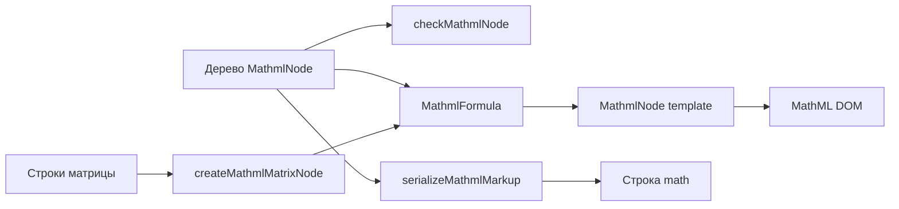

# stylist-svelte-mathml

MathML — второй, наряду с SVG, «чужой» язык, встроенный в HTML. Домен даёт
типизированные Svelte-обёртки для всех элементов MathML Core и компоненты, которые
рисуют формулы из сериализуемого дерева. Формулы рендерит сам браузер: KaTeX,
MathJax и другой JS не нужны, разметка выводится уже при SSR.

Корень `<math>` принадлежит домену `html` (`HtmlMath`, точка встраивания, как
`<svg>`). Здесь лежит всё, что находится внутри него. Это отдельный встроенный
репозиторий в составе design-system, рядом с `svg`.

## Состав

| Кластер     | Сущности                                                                                                                                                                                                                     |
| ----------- | ---------------------------------------------------------------------------------------------------------------------------------------------------------------------------------------------------------------------------- |
| `const`     | `MATHML_ELEMENT`: реестр 29 элементов MathML Core с моделью содержимого и арностью. `MATHML_NAMESPACE`: URI пространства имён. `MATHML_FENCE`: пары скобок.                                                                  |
| `type`      | `MathmlTag`, `MathmlNode` (элемент или `HtmlTextNode`), `MathmlElementNode`, `MathmlFence`.                                                                                                                                  |
| `interface` | `SlotMathmlGlobal`: displaystyle, scriptlevel, mathcolor, mathbackground, mathsize. Recipe каждой обёртки с атрибутами своего элемента, `RecipeMathmlFormula`, `RecipeMathmlMatrix`, `RecipeMathmlNode`.                     |
| `function`  | `checkMathmlNode`: проверка дерева по моделям содержимого Core. `serializeMathmlMarkup`: дерево в строку `<math>`. `createMathmlTokenNode`: значение в `mn`/`mi`/`mo`. `createMathmlMatrixNode`: строки в матрицу в скобках. |
| `component` | 29 атомов `mathml-<тег>` (MathmlMi … MathmlMaction). Template `mathml-node`: рекурсивный рендер дерева. Molecule `mathml-formula`. Organism `mathml-matrix`.                                                                 |
| `test`      | Реестр против списка Svelte, проверка дерева, сериализация, рендер формулы и матрицы, рендер всех 31 историй в пространстве имён MathML.                                                                                     |



## Использование

Формула из данных: дерево сериализуемо, поэтому его можно хранить в БД, передавать
в конструктор и в контролы песочницы.

```svelte
<script lang="ts">
	import MathmlFormula from '$stylist/mathml/component/molecule/mathml-formula/index.svelte';
	import type { MathmlNode } from '$stylist/mathml/type/alias/mathml-node';

	const nodes: MathmlNode[] = [
		{
			kind: 'element',
			tag: 'msup',
			children: [
				{ kind: 'element', tag: 'mi', children: [{ kind: 'text', value: 'x' }] },
				{ kind: 'element', tag: 'mn', children: [{ kind: 'text', value: '2' }] }
			]
		}
	];
</script>

<MathmlFormula {nodes} display="block" alttext="x squared" />
```

Разметка руками: атомы вкладываются внутрь `<math>` или `HtmlMath`.

```svelte
<math display="block">
	<MathmlMfrac><MathmlMi>a</MathmlMi><MathmlMi>b</MathmlMi></MathmlMfrac>
</math>
```

Матрица: `<MathmlMatrix rows={[[1, 0], [0, 1]]} fence="brackets" />`.

## Правила

- Только MathML Core, то есть то, что рендерят Chromium, Firefox и Safari. `<none>`,
  `mfenced`, `menclose` и прочее из MathML 3 не поддерживаются: пустой скрипт — это
  пустой `<mrow>`, скобки — это `<mo fence>`.
- Булевы атрибуты (`fence`, `stretchy`, `accent`, `displaystyle` …) передаются как
  `boolean`, в DOM они попадают строками `"true"`/`"false"`.
- `MathmlFormula` в dev-режиме проверяет дерево через `checkMathmlNode` и пишет
  `console.warn`, если нарушена модель содержимого: например, у `mfrac` не два потомка.
- Шрифт: `var(--font-math, math)`. Если тема не задаёт `--font-math`, используется
  системный математический шрифт.
- Обязателен `alttext` или окружающий текст: это текстовая альтернатива для
  вспомогательных технологий.

## Отложено

Ввод формул в записи LaTeX (LaTeX → MathmlNode) требует отдельного решения:
внешняя зависимость или собственный парсер.
